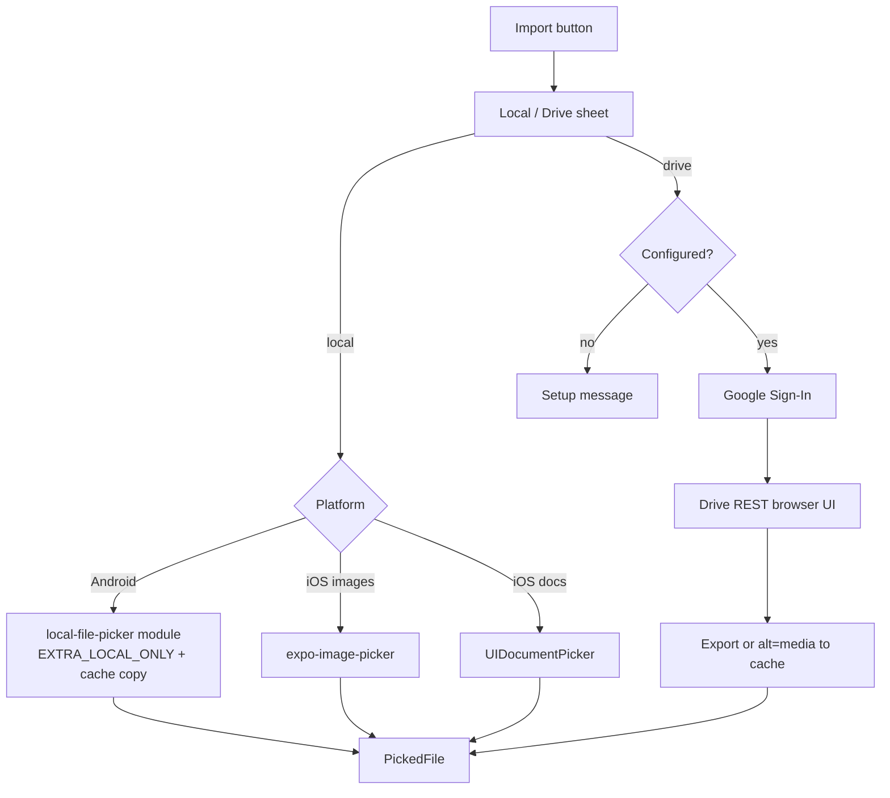

# File picker redesign — Local vs Drive (sez-print)

**Status:** Design only — awaiting approval before implementation.  
**Priority platform:** Android (dev build). iOS behaviour documented but secondary.

---

## 1. Problem statement

The app shows an action sheet with **Local File** and **Drive**. Users report both choices open the **same** system screen that prominently lists Google Drive accounts. That is confusing and wrong:

| Choice | Expected behaviour |
|--------|-------------------|
| **Local File** | Device file manager on local storage (Downloads, internal storage, SD card). **No** Google Drive. |
| **Drive** | Google account chooser → browse **that account's** Google Drive files in-app → download chosen file to cache. |

Today, **Drive** is implemented as “the system document picker with cloud providers enabled,” which is not Google Drive integration and looks identical to Local on many devices.

---

## 2. Inventory — every file-pick call site

### 2.1 Shared infrastructure (current)

| File | Role |
|------|------|
| `src/lib/file-import/use-file-source-sheet.tsx` | Action sheet: Local File / Drive → `requestFileSource()` |
| `src/lib/file-import/use-document-source-picker.tsx` | Wraps sheet + `pickDocumentAsset` for documents |
| `src/lib/file-import/pick-document.ts` | `expo-document-picker` wrapper |
| `src/lib/file-import/pick-image.tsx` | Sheet + gallery (local) or document picker (drive) for images |
| `src/lib/file-import/mime-presets.ts` | MIME / extension presets per `DocumentPreset` |
| `src/lib/use-excel-import-flow.tsx` | Excel pick + header/start-row modal |

### 2.2 Document picks (`useDocumentSourcePicker` / `useExcelImportFlow`)

| Caller | File:line | Preset | Types (via preset) | What happens with result |
|--------|-----------|--------|--------------------|---------------------------|
| PDF editor | `src/app/pdf.tsx:143` | `pdf` | `application/pdf` | `copyPdfToCache` → `loadPdfMetadata` → session (`readAsStringAsync` base64 internally) |
| PDF thermal print | `src/app/pdf-thermal.tsx:181` | `pdf` | PDF | `addPdfFile`; print via `directPrintPdf` / modal (`readAsStringAsync` base64 in print path) |
| Font library | `src/app/font-library.tsx:119` | `font` | TTF/OTF MIME + `*/*` | `importFontFile` → `FileSystem.copyAsync` to app documents |
| Clipart (SVG) | `src/app/clipart.tsx:60` | `svg` | SVG/XML MIME | `FileSystem.readAsStringAsync` → sanitize → store in clipart library |
| Data files screen | `src/app/data-file.tsx:224` | `excel` / `csv` | spreadsheet MIME | `importExcelFromFile` → `parseExcelFile` (reads bytes from cached URI) |
| Data files screen | `src/app/data-file.tsx:241` | `pdf` / `any` | PDF or inferred | PDF → navigate; Excel/CSV → parse |
| Excel print | `src/app/excel-print.tsx` (via `useExcelImportFlow`) | `excel` | spreadsheet MIME | parse → label print flow |
| Label editor (Excel data) | `src/app/edit.tsx` (via `useExcelImportFlow`) | `excel` | spreadsheet MIME | bind rows to label fields |

**Common document result shape today:** `{ ok, name, uri, size?, extension }` where `uri` is already a **local cache file** when `copyToCacheDirectory: true` (expo-document-picker copies on pick).

### 2.3 Image picks (`useImageSourcePicker`)

| Caller | File:line | Local path | Drive path | What happens with result |
|--------|-----------|------------|------------|---------------------------|
| Label editor | `src/app/edit.tsx:3004` | gallery | doc picker `image` | Navigate to `/image-crop` with `uri`, `width`, `height` |
| New label | `src/app/new-label.tsx:77` | gallery | doc picker | image on canvas |
| Label settings | `src/app/label-settings.tsx:237` | gallery | doc picker | background image |
| Scan | `src/app/scan.tsx:166,176` | gallery | doc picker | OCR / import pipeline |
| OCR | `src/app/ocr.tsx:125` | gallery | doc picker | text recognition |
| Image → label | `src/app/img-to-label.tsx:387` | gallery | doc picker | rasterize for label |
| Print photo | `src/app/print-photo.tsx:225` | gallery | doc picker | `pngBase64ToGray` / print |
| Print photo modal | `src/app/print-photo-modal.tsx:19` | gallery | doc picker | same |
| Jewellery label | `src/app/jewellery-label.tsx:59` | gallery | doc picker | template image |
| PDF watermark | `src/components/pdf-editor/pdf-watermark-tool.tsx:85` | gallery | doc picker | watermark image |
| Image property panel | `src/components/editor/image-property-panel.tsx:177` | gallery | doc picker | replace image → crop |

**Local image pick:** `ImagePicker.launchImageLibraryAsync({ mediaTypes: ['images'], quality: 1, allowsEditing: false })` — returns `content://` or `file://` URI; dimensions from asset or `Image.getSize`. **Not** copied to cache by default (callers use URI directly).

**Drive image pick:** `pickDocumentAsset({ preset: 'image', source: 'drive' })` → cached copy via expo-document-picker.

### 2.4 Legacy / dev screens (no Local/Drive sheet)

| Caller | Library | Notes |
|--------|---------|-------|
| `src/app/phase3-image-import.tsx:152` | `expo-image-picker` only | Dev screen; out of scope unless wired later |
| `src/app/phase8-shape-detect.tsx:152` | `expo-image-picker` only | Dev screen |
| `src/app/app-permissions.tsx:26` | `ImagePicker.useMediaLibraryPermissions` | Permissions UI only |

### 2.5 Libraries **not** used

- `react-native-document-picker` — not in project
- Direct `File.pickFileAsync` (`expo-file-system`) — not used by app code

---

## 3. What Local and Drive call **today**

### 3.1 UI entry

```
User taps import
  → useFileSourceSheet.requestFileSource()     [use-file-source-sheet.tsx:27-33]
  → ActionSheet: "Local File" | "Drive"      [use-file-source-sheet.tsx:55-58]
  → returns 'local' | 'drive' | null
```

### 3.2 Document flows

```
useDocumentSourcePicker.pickDocumentWithSource({ preset })
  [use-document-source-picker.tsx:19-23]
  → pickDocumentAsset({ preset, source })
  [pick-document.ts:20-30]
  → DocumentPicker.getDocumentAsync({
       type: preset.mimeTypes,
       copyToCacheDirectory: true,
       multiple: false,
       localOnly: source === 'local',    // patched expo-document-picker
     })
```

| Button | JS call | `localOnly` | Underlying Android intent |
|--------|---------|-------------|---------------------------|
| **Local File** | `getDocumentAsync({ …, localOnly: true })` | `true` | `ACTION_OPEN_DOCUMENT` + `Intent.EXTRA_LOCAL_ONLY = true` (patch) |
| **Drive** | `getDocumentAsync({ …, localOnly: false })` | `false` | `ACTION_OPEN_DOCUMENT` (no `EXTRA_LOCAL_ONLY`) — **same system UI with Google Drive** |

### 3.3 Image flows

| Button | Call | Library |
|--------|------|---------|
| **Local File** | `ImagePicker.launchImageLibraryAsync(...)` | `expo-image-picker` (`pick-image.tsx:17-21`) |
| **Drive** | `pickDocumentAsset({ preset: 'image', source: 'drive' })` | `expo-document-picker` (`pick-image.tsx:40`) |

Images are **partially** segregated (gallery vs system picker). Documents are **not** truly segregated for Drive (still system picker).

### 3.4 `expo-document-picker` 14.0.8 Android source

**Stock (upstream):**

- Intent: `Intent.ACTION_OPEN_DOCUMENT` (`DocumentPickerModule.kt:37`)
- Category: `Intent.CATEGORY_OPENABLE`
- MIME: `type` or `EXTRA_MIME_TYPES` when multiple types
- **Does not** expose `EXTRA_LOCAL_ONLY` or initial folder URI in upstream 14.0.8

**Current repo patch** (`patches/expo-document-picker+14.0.8.patch`):

- Adds `localOnly` option → `Intent.EXTRA_LOCAL_ONLY` when true
- Patch also accidentally includes `.gradle` build artifacts (should be cleaned during implementation)

**iOS:** `UIDocumentPickerViewController(forOpeningContentTypes:asCopy:)` — `localOnly` field exists in patch but is **not applied** in Swift picker creation.

### 3.5 Why both buttons show the same (Drive) screen

1. **Drive is not Google Drive.** It opens the Android Storage Access Framework picker with **all** document providers (Google Drive, Dropbox, etc.). That is the same component family as Local, just without `EXTRA_LOCAL_ONLY`.
2. **`EXTRA_LOCAL_ONLY` is unreliable without a rebuild.** The patch requires a native rebuild (`npx expo run:android`). An old APK still runs stock expo-document-picker.
3. **OEM behaviour.** On some devices (notably **Xiaomi / MIUI**), `EXTRA_LOCAL_ONLY` is ignored or the “Files” app still surfaces cloud shortcuts.
4. **User mental model mismatch.** Even when Local works, opening SAF “Documents UI” can look like “Drive” because Google promotes its provider. Users expect Drive = Google account + Drive files only.

---

## 4. Proposed design

### 4.1 Shared picker API (single entry for all callers)

Replace ad-hoc `useDocumentSourcePicker` / `pickDocumentAsset` / drive branch in `pick-image.tsx` with one module:

```ts
// src/lib/file-import/use-file-picker.ts (proposed)

export type FilePickerSource = 'local' | 'drive';

export type FilePickerOptions = {
  source: FilePickerSource;           // caller may get this from sheet first
  preset?: DocumentPreset;            // existing mime-presets
  types?: string[];                   // override MIME list
  multiple?: boolean;                 // default false
};

export type PickedFile =
  | { ok: false; reason: 'cancelled' | 'invalid' | 'unconfigured' | 'network' | 'auth' }
  | { ok: true; uri: string; name: string; size?: number; mimeType?: string; extension: string };

export function useFilePicker(): {
  /** Shows Local/Drive sheet, then picks. */
  pickFile: (options: Omit<FilePickerOptions, 'source'>) => Promise<PickedFile>;
  /** Pick with explicit source (when sheet already shown). */
  pickFileWithSource: (options: FilePickerOptions) => Promise<PickedFile>;
  fileSourceSheet: ReactNode;
  driveBrowserModal: ReactNode;      // in-app Drive UI when source === 'drive'
};
```

**Contract:**

- `uri` is always a **readable local file** in app cache (or app documents where callers already copy again).
- Return `mimeType` where available (needed for Drive exports).
- All existing callers migrate to `useFilePicker` (or thin wrappers `useImageSourcePicker` / `useDocumentSourcePicker` delegating to it) so behaviour stays the same except Local/Drive semantics.

**Default / fallback:** If `source` omitted in internal helpers, default remains **local** for safety (no accidental cloud picker).

### 4.2 Local — dedicated Expo native module (Android)

**Module:** `modules/local-file-picker` (pattern matches `modules/dev-printer`, `modules/pdf-raster`).

**Native API:**

```ts
pickLocalDocumentAsync(options: {
  mimeTypes: string[];
  multiple?: boolean;
  initialFolder?: 'downloads' | 'documents' | 'root';
}): Promise<{ canceled: boolean; assets: { uri: string; name: string; size?: number; mimeType?: string }[] }>
```

**Android implementation:**

| Piece | Detail |
|-------|--------|
| Intent | `Intent.ACTION_OPEN_DOCUMENT` |
| Local only | `intent.putExtra(Intent.EXTRA_LOCAL_ONLY, true)` |
| Openable | `intent.addCategory(Intent.CATEGORY_OPENABLE)` |
| MIME filter | `type` + `EXTRA_MIME_TYPES` (same as expo-document-picker) |
| Initial folder (API 26+) | `DocumentsContract.EXTRA_INITIAL_URI` — e.g. Downloads: `content://com.android.externalstorage.documents/document/primary:Download` |
| Permissions | **None** for broad storage. SAF returns per-file URI grant. Compatible with Android 10–15 scoped storage. |
| Result handling | `ContentResolver.openInputStream(uri)` → copy to `context.cacheDir/local-file-picker/` (stream; avoid loading whole file into memory) |
| Cancel | `RESULT_CANCELED` → `{ canceled: true }` |
| Large files | Stream copy; optional guard (e.g. reject > 200 MB with clear error) — threshold TBD with product |
| MIUI / Xiaomi | If `EXTRA_LOCAL_ONLY` still shows cloud providers, **fallback intent**: `ACTION_GET_CONTENT` + `EXTRA_LOCAL_ONLY` (some OEMs route differently). Document in module README; user can verify on MIUI device. |

**Why not use existing libraries without native code?**

| Option | Verdict |
|--------|---------|
| `expo-document-picker` + patch | Already tried; couples behaviour to patch-package; no initial folder; Drive still wrongly uses same module; patch polluted with gradle binaries |
| `expo-file-system` `File.pickFileAsync` | Also `ACTION_OPEN_DOCUMENT`, **no** `EXTRA_LOCAL_ONLY`, returns content URI without guaranteed cache copy (`FilePickerContract.kt:24-27`) |
| `expo-image-picker` | Images only; correct for local photos but not PDF/Excel/font |
| `react-native-document-picker` | New dependency; same SAF intent unless forked; no Drive API |

**Chosen approach:** Small owned native module → explicit intent flags, cache copy, initial folder, OEM fallback, no patch-package drift.

**Rebuild required:** Document in README and in-app dev notes: `npx expo run:android` after adding module.

**iOS (local):** Keep `UIDocumentPickerViewController` via expo-document-picker **or** call the same module stub that delegates to system picker. No `EXTRA_LOCAL_ONLY` on iOS.

### 4.3 Drive — Google Sign-In + Drive REST API (Android + iOS)

**Do not** open the system document picker for Drive. That is the root cause of user confusion.

#### 4.3.1 Auth library

Use **`@react-native-google-signin/google-signin`** with **Expo dev client** (config plugin). This project already uses custom native modules and `expo-dev-client`; no Expo Go requirement.

Alternative `expo-auth-session` + Google provider: possible but more manual token refresh; Google Sign-In is better documented for mobile Drive access.

**OAuth scope:** `https://www.googleapis.com/auth/drive.readonly`

> **Restricted scope.** `drive.readonly` requires [Google verification](https://developers.google.com/identity/protocols/oauth2/production-readiness/restricted-scope-verification) for public release. Until verified, keep the OAuth consent screen in **Testing** mode (max **100 test users** listed by email).

#### 4.3.2 Flow

```
Drive button
  → if !isGoogleDriveConfigured(): show setup modal (section 4.3.4); STOP
  → GoogleSignin.signIn()          // account chooser
  → obtain access token with drive.readonly
  → open DriveBrowserModal (in-app)
       - list files: GET drive/v3/files?q=...&fields=...
       - folders: mimeType = application/vnd.google-apps.folder
       - breadcrumbs, search, MIME filter from preset, pagination (pageToken)
  → user selects file
  → if Google Workspace native type: export (see table)
     else: GET drive/v3/files/{id}?alt=media → stream to cache
  → return PickedFile { uri, name, mimeType, size, extension }
```

**Google Workspace export map (minimum):**

| Drive `mimeType` | Export to | Use case in app |
|------------------|-----------|-----------------|
| `application/vnd.google-apps.spreadsheet` | `application/vnd.openxmlformats-officedocument.spreadsheetml.sheet` (.xlsx) | Excel import |
| `application/vnd.google-apps.document` | `application/pdf` | PDF import (or .docx if we add Word later — PDF matches existing PDF flow) |
| `application/vnd.google-apps.presentation` | `application/pdf` | Rare; optional |
| Binary files (pdf, xlsx, png, …) | `alt=media` download | All presets |

#### 4.3.3 Google Cloud setup (placeholders — **you** fill in)

| Step | Action |
|------|--------|
| 1 | Create GCP project (or reuse existing) |
| 2 | Enable **Google Drive API** |
| 3 | Configure **OAuth consent screen** (External, Testing mode initially, add test users) |
| 4 | Create **Android** OAuth client: package `com.sezprint.app`, SHA-1 of **debug** and **release** keystores |
| 5 | Create **Web** OAuth client (required by Google Sign-In for `webClientId`) |
| 6 | Add scope `drive.readonly` to consent screen |

**Where IDs go in the app (no secrets committed):**

```jsonc
// app.json → expo.extra (or app.config.ts reading env)
{
  "googleWebClientId": "<WEB_CLIENT_ID>",      // public OAuth client ID
  "googleDriveConfigured": true               // flip false until setup done
}
```

```bash
# .env.local (gitignored) — optional override
EXPO_PUBLIC_GOOGLE_WEB_CLIENT_ID=<WEB_CLIENT_ID>
```

```ts
// src/lib/drive/config.ts
const webClientId = process.env.EXPO_PUBLIC_GOOGLE_WEB_CLIENT_ID
  ?? Constants.expoConfig?.extra?.googleWebClientId;
export const isGoogleDriveConfigured = () =>
  Boolean(webClientId) && Constants.expoConfig?.extra?.googleDriveConfigured === true;
```

**SHA-1 commands (for your keystore — run locally, do not commit keystore):**

```bash
# Debug (default Android debug keystore)
keytool -list -v -keystore ~/.android/debug.keystore -alias androiddebugkey -storepass android -keypass android

# Release — use your release keystore path
keytool -list -v -keystore /path/to/release.keystore -alias <alias>
```

Add both SHA-1 fingerprints to the Android OAuth client in GCP.

#### 4.3.4 Unconfigured Drive button

If `!isGoogleDriveConfigured()`:

- Show modal: *“Google Drive is not set up for this build. Add OAuth credentials to enable Drive import.”*
- Link to internal dev doc / checklist (section 4.3.3).
- **Do not** call `expo-document-picker` or any system picker.

Same if sign-in fails with `DEVELOPER_ERROR` (wrong SHA-1 / client ID).

### 4.4 iOS behaviour (keep system picker for both)

Apple does not expose “local only” for `UIDocumentPickerViewController`. Proposed labels:

| Button | iOS behaviour |
|--------|----------------|
| **Local File** | **Images:** photo library (`expo-image-picker`). **Documents:** system Files picker; user should choose “On My iPhone” / local folders. |
| **Drive** | System Files picker (iCloud Drive, Google Drive app provider if installed). True in-app Google Drive API can be **phase 2 on iOS** using the same REST browser as Android once Google Sign-In iOS client is configured. |

Phase 1 can ship Android-local module + Android/iOS Drive API; iOS Local stays as today.

### 4.5 Architecture diagram



### 4.6 Caller migration (implementation phase)

| Wrapper | Delegates to |
|---------|----------------|
| `useImageSourcePicker` | `useFilePicker` with `preset: 'image'` + image dimensions helper |
| `useDocumentSourcePicker` | `useFilePicker` without sheet duplication |
| `useExcelImportFlow` | unchanged modal; uses `pickFile` for workbook selection |

Remove dependency on `expo-document-picker` for **Drive** path. Keep optionally for iOS document local until native parity.

Remove or narrow `patches/expo-document-picker+14.0.8.patch` once local module replaces patched `localOnly` usage.

---

## 5. Error handling

| Case | Behaviour |
|------|-----------|
| User cancel | `{ ok: false, reason: 'cancelled' }` |
| Wrong extension / MIME | `{ ok: false, reason: 'invalid' }` + caller alert (unchanged) |
| Drive not configured | `{ ok: false, reason: 'unconfigured' }` + setup modal |
| No network during Drive list/download | Alert + `reason: 'network'` |
| Expired Google token | Silent refresh via Google Sign-In; if fail → re-prompt sign-in |
| File too large | Native/JS guard with clear message before OOM |
| MIUI local still shows cloud | Log + optional user hint; investigate `GET_CONTENT` fallback |

---

## 6. Tests (host / Jest)

No secrets in tests. Mock native modules and Google APIs.

| Test file (proposed) | Covers |
|----------------------|--------|
| `src/lib/file-import/__tests__/file-picker-routing.test.ts` | `source: 'local'` → local module; `source: 'drive'` → drive service; unconfigured drive → no system picker |
| `src/lib/file-import/__tests__/mime-presets.test.ts` | Preset → MIME lists for filters |
| `src/lib/drive/__tests__/drive-export.test.ts` | Workspace MIME → export MIME + extension |
| `src/lib/drive/__tests__/drive-browser.test.ts` | Folder navigation, pagination tokens, search query building |
| `src/lib/file-import/__tests__/caller-wiring.test.ts` | Smoke: excel/pdf/font/svg/image presets map to correct `pickFile` options |

**Device-only verification:**

- Local picker hides Google Drive on Pixel + Samsung + **Xiaomi**
- Drive account chooser + list + download real file
- Large PDF / xlsx download
- Google Sheets → xlsx → Excel import modal
- Native rebuild actually includes `local-file-picker`

**Typecheck:** Run `tsc --noEmit` after implementation; report **new** errors only (baseline may have existing issues).

---

## 7. Risks and open decisions (for you)

| # | Decision | Options / notes |
|---|----------|-----------------|
| 1 | **Google Cloud setup** | Who creates GCP project and adds test users? Required before Drive works. |
| 2 | **Release keystore SHA-1** | Needed for production Drive sign-in; debug SHA-1 enough for dev. |
| 3 | **Drive scope verification** | Public Play release needs Google review for `drive.readonly`; plan timeline. |
| 4 | **Max file size** | Suggest 100–200 MB cap for download/copy — confirm. |
| 5 | **Google Docs import** | Export as PDF only vs also .docx — PDF matches current PDF pipeline. |
| 6 | **iOS Drive API** | Ship Android first; iOS Drive REST in same phase or phase 2? |
| 7 | **Dev screens** | Wire `phase3-image-import` / `phase8-shape-detect` to shared picker? (low priority) |
| 8 | **Remove expo-document-picker patch** | After local module lands; clean gradle junk from patch file. |
| 9 | **Multiple file pick** | Not used today (`multiple: false` everywhere); defer unless needed. |

---

## 8. Implementation phases (after approval)

1. **Shared API** — `useFilePicker`, migrate callers, behaviour unchanged for local images (gallery).
2. **Local module** — `modules/local-file-picker`, Android `EXTRA_LOCAL_ONLY`, cache copy, rebuild docs.
3. **Drive** — config gate, Google Sign-In, REST browser, download/export, setup modal.
4. **Tests** — routing, MIME, export map, error paths.
5. **Cleanup** — remove Drive path from expo-document-picker; trim patch.

---

## 9. References in repo

- Action sheet: `src/lib/file-import/use-file-source-sheet.tsx:55-58`
- Document pick: `src/lib/file-import/pick-document.ts:25-30`
- Image local/drive split: `src/lib/file-import/pick-image.tsx:16-48`
- expo-document-picker Android intent: `node_modules/expo-document-picker/android/.../DocumentPickerModule.kt:37-49`
- expo-file-system picker (no localOnly): `node_modules/expo-file-system/android/.../FilePickerContract.kt:22-35`
- App package name: `app.json` → `android.package`: `com.sezprint.app`
